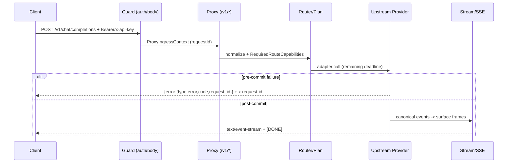

# API



```text
ASCII: Client --Bearer/x-api-key--> Guard(computeBodyLimit/readBoundedJson) --ProxyIngressContext(requestId)--> P(handleProxy) --normalize--> Plan --lease--> Provider --SSE/AbortCoordinator--> Stream(lifecycle gate) --surface--> Client
       Error path: pre-commit -> {error:{code,request_id}} + x-request-id | post-commit -> typed stream terminal (no second JSON)
```

| Decision | Table |
|---|---|
| Auth | `Authorization: Bearer` OR `x-api-key` → `ProxyIngressContext.apiKeyId` |
| Body limit | `OHMYOMOP_ROUTER_MAX_REQUEST_BODY_BYTES` 10MiB [64KiB-64MiB] dual-enforced (guard + RequestLimits) |
| Stream bounds | 64KiB line / 64KiB event / 512KiB buffered / 100k events + cumulative 10MiB (`STREAM_BOUNDS`) |

## Public health and metrics

| Method | Path | Authentication | Purpose |
|---|---|---|---|
| `GET` | `/health` | none | Liveness, version and security headers |
| `GET` | `/health/ready` | none | PostgreSQL/migration readiness |
| `GET` | `/health/overhead` | API key | Sampled request-overhead snapshot |
| `GET` | `/metrics` | API key | Prometheus overhead metrics |

Health responses are `no-store` and include the local version where applicable. `/health` is unauthenticated liveness (`text/plain`, `x-ohmyomop-router-version`); `/health/ready` checks the injected `readiness()` port (PostgreSQL + migrations) and returns `200 {status:"ready", version}` when ready or `503 {status:"not_ready", reason}` otherwise. `/health/ready` does not replace PostgreSQL health checks in deployment orchestration; it reports this process's readiness boundary.

## Public error envelope and request ID

One envelope for every HTTP JSON error (`src/api/guard.ts:errorResponse` + `src/proxy/events/lifecycle.ts:writeErrorResponse` + planner rejection + pre-commit provider failure, sharing a dependency-neutral builder):

```json
{ "error": { "type": "error", "code": "<ProxyErrorCode>", "message": "...", "request_id": "<ProxyIngressContext.requestId>" } }
```

Headers: matching `x-request-id` (same value as `error.request_id`), `cache-control: no-store`, plus current security headers (`x-content-type-options: nosniff`, `x-frame-options: DENY`, CSP, HSTS when HTTPS). `error.type` is always `"error"`. `code` is the typed `ProxyErrorCode` / `ApplicationErrorKind` (`invalid_request`, `authentication_failed`, `model_not_found`, `capability_unsupported`, `provider_unavailable`, `context_overflow`, `stream_timeout`, `ambiguous_model`, etc.) — never derived by substring-matching provider messages. `request_id` is the single `ProxyIngressContext.requestId`; `readBoundedJson`, auth failures, malformed body, and every public `/v1` exit reuse it (no second `randomUUID` per request). OpenAPI contract is `PublicErrorBody` in `src/proxy/types/error-types.ts`.

Pre-commit vs post-commit:

- **Pre-commit** (no visible event yet, including reasoning as meaningful output) → typed HTTP JSON error above with the single envelope + headers.
- **Post-commit** (after first visible event) → one legal typed stream terminal frame for the requested surface and no second HTTP JSON body; `writeErrorResponse` never emits after commit. Provider failure after headers emits one sanitized surface-safe error event without `[DONE]`.

Disconnect: the `AbortSignal` listener installed in `src/api/v1.ts:handleProxy` stays alive through stream completion/cancellation — disposal transfers to the returned stream lifecycle; cancelling the reader aborts upstream exactly once, closes provider/lease/network/capture/telemetry exactly once (`createOwnedStream` + `createReleaseGate`), and telemetry finalization is joined to that outcome.

## Public proxy

Authentication accepts `Authorization: Bearer <key>` or `x-api-key`. Admission enforces API-key/IP limits and concurrency before normalization.

| Method | Path | Surface | Body |
|---|---|---|---|
| `GET` | `/v1/models` | model catalog (visible to API key, 30s merged DB+registry cache, static fallback when `discoverModels` returns `null`) | no body |
| `POST` | `/v1/chat/completions` | `openai-chat` | bounded by `RequestLimits.maxBodyBytes` (dual-enforced: `computeBodyLimit()` ingress + `RequestLimits`) |
| `POST` | `/v1/responses` | `openai-responses` | bounded by `RequestLimits.maxBodyBytes` (dual-enforced) |
| `POST` | `/v1/messages` | `anthropic-messages` | bounded by `RequestLimits.maxBodyBytes` (dual-enforced) |

The production body default is 10 MiB and is clamped 64 KiB–64 MiB via `OHMYOMOP_ROUTER_MAX_REQUEST_BODY_BYTES`. Ingress enforcement is dual: `src/api/guard.ts:computeBodyLimit()` reads live env per request for `readBoundedJson` using `ProxyIngressContext.requestId` for errors (10 MiB fallback, 64 KiB–64 MiB clamp; `CACHED_BODY_LIMIT` is deprecated), and the same value is propagated as `RequestLimits.maxBodyBytes` via `boundedIntegerFromEnv` in `src/runtime/runtime.ts:132` (+ `src/proxy/transport/sse.ts`) for translation/provider validation. Request limits also carry connect, first-body, idle, and total timeouts. The total deadline covers all provider attempts. `PROXY_API_KEY` is never logged; errors expose the single typed envelope above, never raw provider strings. Ambiguous bare model → `400 invalid_request` with `ambiguous_model`; no model → `404 model_not_found`.

### Non-streaming

The request is normalized into canonical protocol types (ordered `ContentPart`, `ToolChoice`, `ResponseFormatConstraint`, `RequiredRouteCapabilities` filtered pre-lease), sent through the selected provider adapter (47 defs, see PROVIDERS.md), transformed into a response document via `foldResponseEvents`, and projected to the requested surface. Errors expose typed `ProxyErrorCode` via the single envelope above (e.g. `context_overflow`, `model_not_found`, `ambiguous_model`, `capability_unsupported`, `provider_unavailable`, `stream_timeout`) with `x-request-id` + `no-store` + security headers. `capability_unsupported` is raised before any lease/network when the target cannot represent the request.

### Streaming

Responses use `text/event-stream` with `no-store`/`x-request-id`/security headers and matching `request_id` in any terminal error frame. The stream parser (`src/proxy/transport/sse.ts` + `src/proxy/transport/sse.ts:STREAM_BOUNDS`) enforces effective caps of 64 KiB line, 64 KiB event, 512 KiB buffered, 100k events (env overrides `OHMYOMOP_ROUTER_MAX_STREAM_*` are clamped to those maxima; `src/runtime/runtime.ts` raw defaults are higher but capped). Additional framing bounds include `framesPerPush` and `framesPerEvent`; outbound `STREAM_BOUNDS` per-frame + cumulative byte limits apply to Chat, Responses, and Messages (Chat-only frame-count removed). Lifecycle gate enforces one start, valid nonempty tool names, each tool closed, at most one usage, one stop, no post-terminal event. `[DONE]` is emitted only after a successful terminal event. If a provider fails after headers, the adapter emits one surface-safe typed terminal error event and closes without appending `[DONE]`. Reader cancellation aborts upstream exactly once and releases lease/network/capture/telemetry once; buffer `Buffer.concat` paths have bounded aggregate/frame checks via `STREAM_BOUNDS`.

## Public share

Public share routes are unauthenticated, backed by `src/api/share.ts` via `createShareRouter({ pool, usage, registry })` (registry injected from `src/bootstrap/application.ts`):

| Method | Path | Purpose |
|---|---|---|
| `GET` | `/share/:token/data` | Monitor share — resolves allowlist/denylist-filtered catalog via registry + `provider_models`/`provider_accounts`, returns usage aggregates (`dailyUsed`/`monthlyUsed`/remaining, `oneTime*`, `totalTokens`, `successCount`/`errorCount`), `no-store` |
| `GET` | `/share/setup/:token/data` | One-time setup share — consumes token via `shareRepo.consumeSetupToken`, returns decrypted key and `baseUrl`/`expiresAt`, `no-store` |

Both reject tokens shorter than 8 chars with typed `not_found` using the same single error envelope + `x-request-id`/`no-store`/security headers. Console share creation is `POST /console/api/keys/:id/share`.

## Console API

Console endpoints are under `/console/api/*`. Login and first-boot setup are unauthenticated; other routes require the HttpOnly `ohmyomop_router_console` session cookie.

| Group | Representative routes |
|---|---|
| Session/setup | `/login`, `/logout`, `/session`, `/setup`, `/setup/status` |
| Providers | `/providers`, `/providers/:id`, OAuth start/callback/session completion |
| Accounts | `/accounts`, OAuth operations, quota read/refresh |
| Models/routing | `/models`, `/models/aliases`, `/models/combos`, `/routes` |
| Keys/security | `/keys`, API-key limits, sessions, IP bans and security settings |
| Proxies | `/proxies`, test, bulk operations |
| WireGuard | `GET /console/api/wireguard/status`, `POST /console/api/wireguard/validate`, `POST /console/api/wireguard/warp/create`, `POST /console/api/wireguard/toggle`, `POST /console/api/wireguard/import` (WireGuard INI → wireproxy SOCKS5 on 127.0.0.1:11080+, validated via `wireproxy -n -c`) |
| Backup | `POST /console/api/settings/backup` (streams `exportBackupStream()` as `application/json` attachment, incremental `ReadableStream` enforcing `MAX_BACKUP_BYTES` 64 MiB), `POST /console/api/settings/restore` (validates envelope/version/columns before `applyRestore`) |
| `Telemetry` | request-event query/aggregates, payload retrieval, console log query/stream |
| Performance | `/overhead`, `/metrics` console mirrors |
| Settings/tools | settings, CLI tools and custom providers |

The exact response shapes are owned by `src/console/api.ts` and the injected service ports. Console log persistence is backed by the configured SQLite/D1 telemetry store, not PostgreSQL `console_logs`. The observability service now delegates usage summary, chart buckets, breakdown rows, cache summary, trace lookup, and batched API-key totals to the telemetry stores instead of regrouping rows in JavaScript.

Console log SSE can be observed directly:

```sh
curl -N "http://127.0.0.1:12800/console/api/logs/stream?category=request" \
  -H "Cookie: ohmyomop_router_console=$CONSOLE_SESSION"
```

The stream starts with an `init` event containing up to 200 lines, then emits ordered `line` events. The dashboard reconnects after a disconnect and discards events at or below its last id watermark.

### Route and model cache nuance

- `/v1/models` (`src/bootstrap/public-ports.ts`) is cached 30 seconds merged DB rows + registry models, single-flight deduplicated; invalidated immediately via `invalidateModelCache()` on provider/model mutations or after TTL.
- `src/proxy/routing/plan.ts` caches `ProxyRoutePlan` per `RoutingSnapshot` (WeakMap, 256-entry LRU) keyed by model + affinity. When `isAccountEligible` is supplied (as in `RequestExecutor.execute()` via `accountManager.createEligibilityPredicate()`), the cache is bypassed (`routePlanCacheBypasses`) because eligibility affects account filtering, rendezvous ordering and `MAX_CANDIDATES`.

## Security headers

The API guard applies `cache-control: no-store`, `x-request-id` (mirroring `error.request_id`), HSTS when appropriate, CSP, `x-content-type-options: nosniff`, and `x-frame-options: DENY`. Every typed error (public `/v1`, share, console) uses the same single envelope `{error:{type:"error",code,message,request_id}}` via the shared builder — typed `kind` mapping, never provider substring. Post-commit failures are one legal stream terminal, not a second JSON body. Upstream URLs and proxy URLs pass SSRF/public-address validation before network use. Abort propagation on disconnect is exactly-once (`createReleaseGate`/`createOwnedStream`).

## Reproduce locally

Start the server with a configured `.env`:

```sh
bun run dev
```

Health and authentication:

```sh
curl -i http://127.0.0.1:12800/health
curl -i http://127.0.0.1:12800/health/ready
curl -i http://127.0.0.1:12800/v1/models \
  -H "x-api-key: $PROXY_API_KEY"
```

Expected observations:

- `/health` is reachable without an API key and includes the local version.
- `/health/ready` reports PostgreSQL/migration readiness (`200 ready` vs `503 not_ready`).
- `/v1/models` without authentication returns an authentication error; with `x-api-key` it returns the visible catalog (cached 30s).

Exercise a non-streaming request:

```sh
curl -sS http://127.0.0.1:12800/v1/chat/completions \
  -H "Authorization: Bearer $PROXY_API_KEY" \
  -H "content-type: application/json" \
  -d '{"model":"openai/gpt-4o-mini","messages":[{"role":"user","content":"Reply with exactly: pong"}],"stream":false}' | jq .
```

Exercise reasoning (effort/mode) — non-streaming with OpenAI Responses surface:

```sh
curl -s http://127.0.0.1:12800/v1/responses -H "x-api-key: $PROXY_API_KEY" -H "content-type: application/json" -d '{"model":"openai/gpt-5-mini","input":[{"role":"user","content":"hi"}],"reasoning":{"effort":"medium","summary":"auto"},"stream":false}' | jq .
```

File upload (PDF/image via multipart or base64 content part) — proxy normalizes to `ContentPart pdf/image` and projects per model `images` capability:

```sh
curl -s http://127.0.0.1:12800/v1/chat/completions -H "x-api-key: $PROXY_API_KEY" -H "content-type: application/json" -d '{"model":"openai/gpt-4o-mini","messages":[{"role":"user","content":[{"type":"text","text":"Summarize"},{"type":"image_url","image_url":{"url":"data:image/png;base64,iVBORw0KGgo..."}}]}]}' | jq .
```

Exercise SSE framing:

```sh
curl -N http://127.0.0.1:12800/v1/chat/completions \
  -H "x-api-key: $PROXY_API_KEY" \
  -H "content-type: application/json" \
  -d '{"model":"openai/gpt-4o-mini","messages":[{"role":"user","content":"Say hello"}],"stream":true}'
```

The successful stream ends with `data: [DONE]`. A provider error after headers must produce a sanitized surface error event and must not append `[DONE]`.

For deterministic behavior that does not require provider credentials, run:

```sh
bun test src/proxy/transport/sse.test.ts src/proxy/transport/sse.test.ts src/proxy/surface.test.ts --timeout 60000
```
