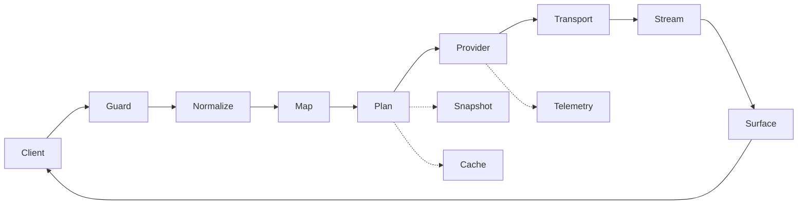

# Architecture

> Merged: Architecture + Routing + Translation — ownership, request path, routing order, translation contracts.



```text
ASCII: Client -> Guard(auth/body) -> Normalize(openai/anthropic/gemini) -> CLI Mapping -> Plan(alias/combo/capability) -> Account/Network -> Provider -> SSE/Abort -> Lifecycle -> Surface
```

## 1. Ownership Map

```text
src/bootstrap   composition, runtime config, proxy port, console wiring and lifecycle
src/api         public `/v1/*` boundary, guards and surface dispatch
src/console     authenticated console router and service ports — orchestrator `src/console/api.ts` composes domain routers `src/console/routes/{auth,providers,accounts,catalog,proxies,observability,system}.ts` + `src/console/wireguard-helpers.ts` (Phase 4.1)
src/proxy       single source of truth — canonical proxy boundary: `types/*` + `normalize/*` (openai/chat|responses|reasoning + anthropic/normalize|payload|response + detection/tools; barrels at normalize/openai.ts + normalize/anthropic.ts) + `translate/*` (request/response/policy/cross-surface/stream/cache single owner + passthrough) + `events/*` (assembly/lifecycle/commit/repair/tool-assembler/signature) + `transport/*` (sse/abort/fetch/network/errors/response) + `routing/*` (plan/account/mapping/capability) + `request/*` (prepare/attempt/execute) + `upstream/*` (openai/anthropic/gemini/adapter) + `policy/*` (profiles/projection) + `protocol-request.ts`
src/providers   registry 47 defs (10 oauth+37 api_key, 41 eager +5 lazy →46) + catalog/discovery (`fetch-models.ts` + inline `oauth-provider/cursor.ts:GetUsableModels` http2 + `oauth-provider/devin.ts:GetCliModelConfigs` protobuf) + quota fetch (see PROVIDERS.md)
src/auth        OAuth driver registry, login sessions, refresh and bounded OAuth HTTP
src/compression Ponytail, RTK, token saving and filter policy
src/persistence PostgreSQL repositories plus SQLite/D1 telemetry pipeline and store-side aggregates
src/runtime     version, limits, admission, concurrency, in-flight state and overhead
```

There are no active `src/application`, `src/codec`, `src/traffic`, or PostgreSQL telemetry layers (`src/proxy/transport` IS active for SSE/fetch/SSRF). There is no `src/proxy/openai.ts` monolith and no duplicate planner in `src/proxy/routing/model-chain.ts` — imports target direct owners (`src/proxy/normalize/openai.ts` barrel + `src/proxy/normalize/openai/{chat,responses,reasoning}.ts` splits, `src/proxy/normalize/anthropic.ts` barrel + `src/proxy/normalize/anthropic/{normalize,payload,response}.ts` splits, `src/proxy/translate/request.ts`, `src/proxy/translate/cache.ts` single cache owner (request.ts re-exports), `src/proxy/translate/response.ts`, `src/proxy/upstream/dispatch.ts` shared coordinator, `src/proxy/routing/plan.ts`). Tool repair lives only in `src/proxy/normalize/tools.ts:repairToolCallRequest` and `src/proxy/events/repair.ts`. Import domain symbols directly from their owning files; barrels exist only at `normalize/openai.ts` and `normalize/anthropic.ts` for backwards compat (Phase 4.2/4.3).

## Protocol ownership (direct modules)

## 2. Request Path

```text
main.ts
  → bootstrap/bootstrap.ts
  → loadRuntimeConfig + PostgreSQL pool/migrations/readiness
  → coordination (Redis when configured, local bounded fallback)
  → telemetry pipeline (D1 when URL+token exist, otherwise SQLite)
  → default provider registry
  → proxy port
  → public guard/auth/body limit (readBoundedJson uses ProxyIngressContext.requestId)
  → single ingress detection → ProxyIngressContext (one requestId, one FormatDetectionResult, one ClientIdentity, endpoint, apiKeyId, disableRemoteMapping)
  → normalization (openai-normalize / anthropic / gemini → ordered ProxyRequest with ToolChoice + ResponseFormatConstraint)
  → CLI mapping (resolveCliModelMapping with allowlist gate, trim+case-fold, Claude family) then route plan
  → route snapshot / aliases / combos / RequiredRouteCapabilities pre-lease filtering
  → account, credential and network selection (only after capability filtering)
  → provider adapter.call
  → upstream fetch + SSRF + AbortCoordinator
  → canonical stream events (lifecycle gate validates order)
  → surface encoder (single public error envelope pre-commit; stream terminal post-commit)
  → response and telemetry finalization
```

`RequestLimits` is the single request framing contract: body (`OHMYOMOP_ROUTER_MAX_REQUEST_BODY_BYTES` 10MiB clamped 64KiB–64MiB), connect, first-body, idle, and total timeout values. The ingress body limit is enforced dually — `src/api/guard.ts:computeBodyLimit()` reads live env per request for `readBoundedJson`, and the same value is propagated as `RequestLimits.maxBodyBytes` for translation/provider validation (`boundedIntegerFromEnv` in `src/runtime/runtime.ts:132` + `src/proxy/transport/sse.ts:STREAM_BOUNDS`). The total deadline is created once before provider attempts. Each attempt receives the remaining total budget; retries cannot extend the request deadline.

`ProxyIngressContext` is threaded through `ProxyRequestPort.handle`, `src/api/v1.ts:handleProxy`, `src/proxy/request/execute.ts:handleProxyPortRequest/runProxyRequest`, `prepareProxyRequest`, and `createProxyPort` — no second detection in the live path, no second requestId. `src/proxy/normalize/detection.ts` precedence is explicit recognized helper/header, recognized client UA, body shape, earliest recognized bounded system/developer marker, endpoint; arbitrary UA is `rawUserAgent` only. Conflicts among bounded marker/body/endpoint/recognized UA are recorded without prompt text.

## Stream behavior

## 3. Protocol Ownership

```text
src/proxy/types/content.ts               ContentPart (ordered, discriminated: text/image/pdf/video/tool_use/tool_result/reasoning/compaction/native/unknown), NormalizedTool union (function/hosted/native/opaque), NormalizedMessage
src/proxy/types/request.ts               ProxyRequest (ordered ContentPart + ToolChoice + ResponseFormatConstraint), ProxyIngressContext (single requestId + FormatDetectionResult + ClientIdentity + endpoint + apiKeyId + disableRemoteMapping), ToolChoice, ResponseFormatConstraint
src/proxy/types/stream.ts                StreamEvent + terminal outcome (completed/incomplete/failed/cancelled) — isTerminalEvent only on final message_stop
src/proxy/types/routing.ts               RequiredRouteCapabilities (tools/hostedSearch/reasoning/image/pdf/video/responseFormat/sourceSurface), ProxyRoutePlan with failureCode
src/proxy/normalize/openai.ts            barrel → normalizeChatRequest (openai/chat.ts) / normalizeResponsesRequest (openai/responses.ts) + REASONING_EFFORTS/parseReasoningConfig (openai/reasoning.ts)
src/proxy/normalize/anthropic.ts         barrel → normalizeMessagesRequest (anthropic/normalize.ts) / buildMessagesPayload (anthropic/payload.ts) / translateAnthropicResponse (anthropic/response.ts)
src/proxy/translate/cache.ts             CachePlan, shouldBuildCachePlan, markCacheSections, applyCachePlan, findCacheBreakpoint, resolvePromptCacheKey (single owner)
src/proxy/translate/request.ts           buildChatPayload / buildResponsesPayload / toResponsesTool / toResponsesItem (re-exports cache symbols)
src/proxy/translate/response.ts          translateOpenAIChatResponse / translateOpenAIResponsesResponse
src/proxy/upstream/dispatch.ts           dispatchWithCoordinator — shared fetch + AbortCoordinator + SSE mapping for openai/anthropic/gemini adapters (Phase 4.4)
src/proxy/events/assembly.ts             foldResponseEvents + orderedResponseItems (single ordered fold for non-stream)
src/proxy/normalize/tools.ts             normalizeToolList (structural kind classifier), repairToolCallRequest (sole ID/orphan repair)
src/proxy/normalize/detection.ts         single ingress detection — explicit header > recognized UA > body shape > earliest bounded marker > endpoint; conflicts recorded without prompt text
src/proxy/translate/cross-surface.ts     cross-surface translateResponseDocument (full fold, rejects nonrepresentable opaque/native/context)
```

Canonical types: `ContentPart` reasoning retains visible text, summary, opaque encrypted payload, signature, raw source item and source surface in order; internal side channels (`reasoningContent`, `reasoningItemsBefore`, `reasoningItems`, `trailingReasoningItems`) are deleted. `ToolChoice` is `auto|none|required` or `{kind:"function", name}`; `ResponseFormatConstraint` is `text|json_object|json_schema{ schema }` (single field, not `responseFormat`+`responseFormatSchema`). `isWebSearchTool` matches only `kind:"hosted"` + `hostedType:"web_search"`; a function named `web_search` is never rerouted.

Capability projection: every payload builder (`buildChatPayload`, `buildResponsesPayload`, `buildMessagesPayload`, `buildGeminiPayload`) projects each canonical tool/choice/parallel/format value — emitting the legal target equivalent or throwing `ProtocolCodecError` with `capability_unsupported` before provider dispatch (no silent downgrade).

## Version identity

## 4. Routing

## Ownership

```text
src/proxy/routing/plan.ts          facade and route-plan entry point (re-exports isWebSearchTool with NormalizedTool type)
src/proxy/routing/plan.ts           single recursive resolver — snapshot sources, alias/combo expansion, bare-model index, capability filtering, BoundedRouteSessionStore (`routePlanCache` WeakMap 256 LRU, `MAX_ALIAS_DEPTH 8`, `MAX_DIAGNOSTICS 32`, `MAX_CANDIDATES 64`)
src/proxy/translate/cache.ts        single cache-plan owner (CachePlan, shouldBuildCachePlan, markCacheSections, buildCachePlan, applyCachePlan, findCacheBreakpoint, resolvePromptCacheKey; request.ts re-exports for compat)
src/proxy/routing/model-chain.ts    legacy alias helper only — live expansion deleted; plan.ts is the sole resolver
src/proxy/routing/account.ts    tool-scoped CLI model mappings (resolveCliModelMapping with allowlist gate)
src/proxy/routing/account-state.ts  health, isWebSearchTool(NormalizedTool) and model-lock ports
src/proxy/routing/session-state.ts  bounded route/session affinity state (not round-robin)
src/proxy/request/           prepare, capture, attempt and executor lifecycle
src/proxy/types/routing.ts RequiredRouteCapabilities (tools/hostedSearch/reasoning/image/pdf/video/responseFormat/sourceSurface), ProxyRoutePlan diagnostics/failureCode, RouteSessionState
src/proxy/normalize/detection.ts     single ingress format detection (precedence for planner ordering)
src/auth/                     OAuth driver registry, sessions and refresh
```

`src/persistence/persistence-api.ts` supplies repository-backed models, aliases, combos, CLI mappings, accounts and proxies. PostgreSQL remains the durable source; the router consumes injected ports rather than issuing SQL directly. No duplicate repair/planner remains (`repairToolCallRequest` is only in `src/proxy/normalize/tools.ts`; combo/alias expansion is only in `plan.ts`).

## Effective order (detection → mapping → planner)

```text
ProxyIngressContext (single requestId + FormatDetectionResult + ClientIdentity + endpoint + apiKeyId)
  → prepareProxyRequest (ordered ContentPart + ToolChoice + ResponseFormatConstraint + repair)
  → RequiredRouteCapabilities derived immediately after preparation
  → resolveCliModelMapping(client, sourceModel, apiKeyId, mappings) → raw + mapped model
  → createRoutePlan({ requestedModel: mapped, rawRequestedModel, mappedModel, sourceSurface, requiredCapabilities, snapshot, affinityKey, routeSessionStore })
  → pre-lease capability filtering + wire-surface resolution (resolveModelWireSurface) before any account/network lease
```

CLI mapping allowlist gate (`src/proxy/routing/account.ts:resolveCliModelMapping` + `src/proxy/types/request.ts:ProxyIngressContext` + `src/persistence/repositories/routing-config.ts`):

- `CliModelMappingSnapshot.allowedApiKeyIds` present (including `[]`) → only listed authenticated `apiKeyId` may use the mapping (empty = no key allowed).
- `allowedApiKeyIds` absent (`undefined`, legacy in-memory fixtures) → unrestricted.
- Disabled mapping or unallowlisted/disabled key → returns raw requested model.
- Trim + case-fold `sourceModel` for every client; Claude additionally family-matches (`opus|sonnet|haiku|fable|mythos`).

## Route snapshot

A route snapshot combines provider models, aliases, combos, CLI mappings, accounts, proxies, account health, quota and model locks. The snapshot cache deduplicates concurrent rebuilds and is invalidated immediately after routing mutations. Repository composition exposes `invalidateRouteSnapshot()` for local invalidation; coordination revision publication handles multi-instance refresh when wired.

Combo lookup is by persisted combo **ID** in both `src/persistence/repositories/routing-config.ts` snapshots and `src/bootstrap/proxy-port.ts` (display `name` stays display-only).

## Plan construction

1. Single ingress detection already in `ProxyIngressContext` (explicit recognized header/helper > recognized UA > body shape > earliest bounded marker > endpoint; conflicts recorded).
2. CLI mapping via `resolveCliModelMapping` with allowlist gate and trim/case-fold (+ Claude family).
3. Alias resolution with one active-path set, cycle and `MAX_ALIAS_DEPTH 8` guards, `MAX_DIAGNOSTICS 32`.
4. Combo expansion — fallback keeps configured member order; round-robin rotates via `BoundedRouteSessionStore` (see below); recursive resolution with shared depth/diagnostics/duplicate-removal; duplicate candidates removed.
5. Qualified `provider/model` parse and bare-model index resolution (see Invariants). Wire surface resolved via `resolveModelWireSurface` policy + model metadata (`surface: openai-chat` hardcoded removed) during plan construction.
6. Pre-lease `RequiredRouteCapabilities` filtering (tools, hosted search, reasoning, image/pdf/video parts, response format, required projection) — candidates that cannot accept/project are removed before account/network selection; `selectWireSurfaceAttempt` only asserts the planned wire surface.
7. Apply cache classification and stable-prefix metadata; select eligible account candidates using health, cooldown, quota, locks and affinity (rendezvous).

Aliases and combos are bounded. A malformed cycle or empty combo produces a typed diagnostic instead of unbounded recursion. Diagnostics include `ambiguous_model` and `capability_unsupported`.

### Persisted strategies

- **Fallback** — uses configured member order exactly (no reordering).
- **Round-robin** — via `BoundedRouteSessionStore<{nextIndex, uses}>` instantiated in `createProxyPort` (bounded session pattern: 256 entries, 30-minute idle TTL). Key is `revision\u0000comboId\u0000affinity` (affinity = `namespace:value`). On each plan, rotation advances `nextIndex`; after `sticky_limit` selections (positive persisted value) `nextIndex` advances and `uses` resets. Instantiated per proxy process; revision part of key discards prior rotation on config change. In `plan.ts` `resolveTargets` order for round-robin is `members.slice(nextIndex) + slice(0,nextIndex)` then store update; fallback is not rotated.

## Request execution

```text
prepareProxyRequest
  → normalize body using injected RequestLimits
  → create one total deadline
  → derive RequiredRouteCapabilities + mapped model + wire surface (plan-time, pre-lease)
  → select/lease candidate
  → refresh OAuth credential when required
  → select network/proxy
  → adapter.call with remaining total timeout (wire surface already planned)
  → canonical output/stream events (lifecycle gate)
  → release lease in finally
```

The total request deadline covers all attempts. Before every provider call, the executor computes remaining time and passes the smaller of the provider-configured total timeout and remaining request budget. If no time remains, it raises a retryable timeout without starting another provider. Route metadata stores four identities: raw requested model, CLI-mapped model, selected `providerId/modelId`, and `RouteTarget.upstreamModelId` plus planned wire surface — through `RequestRoutingMetadata` → `TelemetryFinish`/`TelemetryEvent` → `src/bootstrap/proxy-port.ts` telemetry writer → SQLite/D1 → `src/console/services/observability.ts`.

Only retryable errors can select another candidate. Non-retryable errors release the current lease and propagate immediately. Retry is also blocked after semantic stream output commits, after terminal output, when no candidates remain, or when the total deadline expires.

Pre- vs post-commit: `src/proxy/request/execute.ts:runProxyRequest` (and legacy `RequestExecutor.execute`) wrap iteration in `try/catch/finally` and settle the common outcome before telemetry. Pre-first-visible-event (including reasoning) failure → uncommitted typed HTTP error; post-commit failure → one typed stream terminal, not a 200/null telemetry success, and not retried.

## Account/auth behavior

OAuth account leases use the auth refresher's single-flight/lease/CAS path. API-key authentication uses a digest-keyed, short-TTL process cache that does not retain plaintext secrets indefinitely. Revoked/inactive records remain rejected after cache expiry.

## Invariants

- Snapshot reads are revision-consistent.
- Repository mutations invalidate local route state immediately.
- Route/session state is bounded and does not store raw prompts or credentials.
- A lease is released exactly once.
- A failed provider cannot silently become a successful truncated stream.
- **Bare-model resolution:** `modelId → sorted provider IDs`. Single owner → one candidate; multiple owners → `ambiguous_model` diagnostic, no candidate, `failureCode:"ambiguous_model"` (400 `invalid_request`), not first-provider. No owner → `model_not_found` diagnostic, `failureCode:"model_not_found"` (404). First-provider fallback deleted.
- **Pre-lease filtering:** `RequiredRouteCapabilities` + `resolveModelWireSurface` filter before lease/network; incompatibility throws `capability_unsupported` before dispatch (never discovered after lease in `selectWireSurfaceAttempt`).
- **Mapping allowlist:** `allowedApiKeyIds` present (including `[]`) is an explicit allowlist; `[]` maps no keys; absent is unrestricted (old in-memory fixtures). Source model match is trim+case-fold (every client) then Claude family.
- **Combo identity:** lookup by combo ID; `name` is display-only.

## Reproduce routing behavior

The repository includes deterministic tests for the two highest-risk routing invariants:

```sh
bun test src/proxy/routing/routing-reliability.test.ts src/proxy/routing/plan.test.ts src/proxy/request/prepare.test.ts src/proxy/routing/route.test.ts src/proxy/request/executor.test.ts --timeout 60000
```

The test demonstrates that:

1. two repository factories do not share a route-snapshot cache;
2. invalidating one repository causes its next snapshot read to hit the source again;
3. a non-retryable error invokes only the first candidate.

With a running instance, inspect the configured route inputs through the console:

```sh
curl -sS http://127.0.0.1:12800/console/api/models/aliases \
  -H "Cookie: ohmyomop_router_console=$CONSOLE_SESSION" | jq .
curl -sS http://127.0.0.1:12800/console/api/models/combos \
  -H "Cookie: ohmyomop_router_console=$CONSOLE_SESSION" | jq .
```

Create or change an alias/combo in the dashboard, then repeat the request. The next route snapshot must reflect the mutation without waiting for the normal snapshot TTL.

## 5. Translation

## Ownership

```text
src/proxy/types/*            canonical request/content/provider/routing/error/stream/telemetry shapes
src/proxy/types/content.ts    ContentPart ordered union, NormalizedTool (function/hosted/native/opaque), ToolChoice, ResponseFormatConstraint
src/proxy/types/request.ts    ProxyRequest (ordered parts), ProxyIngressContext, ClientIdentity
src/proxy/types/stream.ts      StreamEvent + terminal outcome (completed/incomplete/failed/cancelled)
src/proxy/types/routing.ts     RequiredRouteCapabilities + ProxyRoutePlan
src/proxy/normalize/detection.ts       single ingress detection (header > recognized UA > body shape > bounded marker > endpoint)
src/proxy/normalize/openai.ts          Chat + Responses normalization (content/tool/reasoning/controls) — barrel re-exporting openai/chat.ts + openai/responses.ts + openai/reasoning.ts (Phase 4.2)
src/proxy/translate/cache.ts            CachePlan, shouldBuildCachePlan, markCacheSections, buildCachePlan, applyCachePlan, findCacheBreakpoint, resolvePromptCacheKey (single owner; request.ts re-exports for backwards compat)
src/proxy/translate/request.ts          buildChatPayload / buildResponsesPayload / toResponsesTool / toResponsesItem (cache logic owned by cache.ts)
src/proxy/translate/response.ts         translateOpenAIChatResponse / translateOpenAIResponsesResponse
src/proxy/events/assembly.ts            foldResponseEvents + orderedResponseItems (ordered canonical fold)
src/proxy/upstream/gemini.ts           Gemini payload and response transforms (buildGeminiPayload, mapGeminiUsage, translateGeminiResponse)
src/proxy/translate/cross-surface.ts    cross-surface translateResponseDocument (folded doc, typed capability rejection)
src/proxy/validation.ts                 narrowing, bounded JSON, usage and shared validation
src/proxy/translate/policy.ts           capabilities, extension policy, resolveModelWireSurface and retry policy
src/proxy/normalize/tools.ts            normalizeToolList (structural kind classifier), repairToolCallRequest (sole ledger repair) + events/repair.ts
```

Provider adapters do not invent a second request model. They receive canonical requests, emit canonical response documents/events, and own only their upstream dispatch details via `src/proxy/upstream/*` (shared `dispatchWithCoordinator` in `src/proxy/upstream/dispatch.ts` Phase 4.4). There is no `src/proxy/openai.ts` monolith — OpenAI is split across `proxy/normalize/openai.ts` (`openai/chat.ts`/`responses.ts`/`reasoning.ts`) / `proxy/translate/{request,response,cache}` / `proxy/translate/cross-surface.ts`. Tool repair lives only in `src/proxy/normalize/tools.ts:repairToolCallRequest` and `src/proxy/events/repair.ts`. Cache plan is single-owned by `src/proxy/translate/cache.ts`; `src/proxy/translate/request.ts` re-exports cache symbols to preserve existing import paths.

## Ordered request/content contract

Canonical request (`ProxyRequest` in `src/proxy/types/request.ts`):

- Ordered `ContentPart[]` per `src/proxy/types/content.ts` — `text | image | pdf | video | tool_use | tool_result | reasoning | compaction | native | unknown`. Reasoning preserves visible text, summary blocks, opaque encrypted payload, signature, raw source item, and source surface in arrival order; internal side channels (`reasoningContent`, `reasoningItemsBefore`, `reasoningItems`, `trailingReasoningItems`) are deleted.
- `NormalizedTool` discriminated union: `function { name, description, inputSchema, strict? }`, `hosted { hostedType: web_search|web_fetch, nativeOptions, raw? }`, `native { nativeType, nativeOptions, raw? }`, `opaque { nativeType, raw }`. Structural classification in `normalizeToolList` — a function named `web_search` stays `kind:"function"`; only `kind:"hosted"` participates in hosted-search policy. `isWebSearchTool` matches only `kind:"hosted"`+`web_search`.
- `ToolChoice` is `{kind:"auto"|"none"|"required"} | {kind:"function", name}`; `parallelToolCalls` is a separate optional boolean. Both Chat/Responses/Messages normalizers map into it (Anthropic `auto/none/any/named/disable_parallel_tool_use` → canonical choice). `ResponseFormatConstraint` is `text | json_object | json_schema{ schema }` — migrated from `responseFormat`+`responseFormatSchema` into one field.
- `ToolCallLedger` + `repairToolCallRequest` is the sole ID sanitation/duplicate/orphan/missing-result repair. `src/proxy/request/prepare.ts:applyFusedCompression` applies compression/filter transforms then calls `repairToolCallRequest` once — generating `toolResultIsError:true` + `No result provided` adjacent to the owning assistant message. No duplicate repair in prepare.
- Ingress is one `ProxyIngressContext` (requestId, single `FormatDetectionResult`, `ClientIdentity`, normalized endpoint/source surface, `apiKeyId`, `disableRemoteMapping`) threaded from `ProxyRequestPort.handle` through `handleProxy`/`runProxyRequest`/`prepareProxyRequest`/`createProxyPort`. Detection precedence is explicit recognized helper/header, recognized client UA, body shape, earliest recognized bounded system/developer marker, endpoint; arbitrary UA is `rawUserAgent` only. All bounded markers scanned in order; conflicts noted without prompt text.

## Surface detection and normalization

| Stage | Behavior |
|---|---|
| Endpoint | `/v1/chat/completions` → `openai-chat`; `/v1/responses` → `openai-responses`; `/v1/messages` → `anthropic-messages`; `/v1/models` is catalog-only (see `src/proxy/translate/cross-surface.ts:detectClientFormat` + `src/proxy/types/surface.ts: Surface = openai-chat\|openai-responses\|anthropic-messages\|web-search\|images`) |
| Client format | single `FormatDetectionResult` via `src/proxy/normalize/detection.ts` — explicit recognized header/helper > recognized UA > body shape > earliest bounded marker > endpoint, with diagnostics (`ClientFormat`/`FormatDetectionResult`). Arbitrary UA recorded only as `rawUserAgent`; bounded-marker/body/endpoint/recognized-UA conflicts recorded without prompt text |
| Body parse | JSON-only request body with `RequestLimits.maxBodyBytes` (`OHMYOMOP_ROUTER_MAX_REQUEST_BODY_BYTES` 10MiB `runtime.ts:132`); `readBoundedJson` uses `ProxyIngressContext.requestId` (no second ID). Oversized or multi-document bodies fail before routing |
| Normalization | OpenAI Chat (`src/proxy/normalize/openai.ts:normalizeChatRequest`), OpenAI Responses (`normalizeResponsesRequest`), Anthropic Messages (`src/proxy/normalize/anthropic.ts:normalizeMessagesRequest`), Gemini (`src/proxy/upstream/gemini.ts:buildGeminiPayload`) converge on canonical ordered `ProxyRequest` with bounds `MAX_MODEL_LENGTH 256`, `MAX_MESSAGE_COUNT 2048` etc. Controls map to `ToolChoice`/`ResponseFormatConstraint`/`parallelToolCalls`; response-format/metadata preserved across compatible OpenAI-surface translations |

`prepareProxyRequest` receives the runtime `RequestLimits` created by bootstrap. It no longer owns a live-path fallback timeout object. Auth/body failures share the ingress `requestId`.

## Canonical event/outcome lifecycle

`src/proxy/types/stream.ts` terminal outcome: `completed | incomplete | failed | cancelled` carried on the final `message_stop`. `isTerminalEvent` recognizes only that final frame; all preceding lifecycle events are non-terminal. Terminal classification (`src/proxy/events/lifecycle.ts:classifyTerminal`) — `error` → failed; `length|content_filter|safety|empty|incomplete|cancelled|compaction` → incomplete; `completed|tool_call|pause_turn` → completed — preserved in each public surface's legal terminal fields.

`src/proxy/events/assembly.ts:foldResponseEvents` + `orderedResponseItems` is the single ordered fold: preserves arrival order across text, reasoning/signatures, tool start/delta/end, native start/delta/stop, server-tool result, context item, compaction, usage cache read/write, and terminal error/outcome. Provider tool call IDs/names validated — empty/missing name → typed `provider_protocol_error`, never `name:""`. Non-stream materializers fold canonical events (no independent text accumulator); direct `openai-responses↔anthropic-messages` registrations in `src/proxy/translate/cross-surface.ts`; `translateResponseDocument` projects the full folded document and rejects a nonrepresentable opaque/native/context item with typed capability error (never relabels/drops).…

## Normalizers

OpenAI Chat and Responses preserve supported reasoning, tool calls, multimodal parts (`images` via cursor/devin `supportsImages`), response items and cache metadata while applying bounded model/message/tool/image limits. Anthropic normalization handles `max_tokens`, thinking budgets, effort, cache controls, MCP fields and tool results. Gemini payload construction (`src/proxy/upstream/gemini.ts`) remaps roles, sanitizes function schemas and maps thinking configuration. All via `src/proxy/validation.ts` narrowing + `ToolCallLedger` + `repairToolCallRequest` (sole repair; ledger sanitizes IDs, de-duplicates, repairs orphans/missing results adjacent to owner).

All normalizers use shared narrowing and bounded JSON helpers. Image references pass SSRF classification; oversized data URLs and private/loopback/CGNAT destinations are rejected. `normalizeToolList` classifies structurally (OpenAI function → `function`, explicit Responses hosted → `hosted`, Anthropic/provider built-ins → `native`, unknown native → `opaque`); never fabricates a fake function schema for a non-function tool; preserves `strict`, custom/freeform format, raw upstream object, and native options.

## Pre-dispatch capability projection

Every payload builder projects each canonical tool/choice/parallel/format value to its upstream law — emitting the legal equivalent or throwing `ProtocolCodecError` with `capability_unsupported` before provider invocation. Same-surface custom/native objects stay structurally intact; identity is never inferred from a name. `src/proxy/routing/plan.ts` derives immutable `RequiredRouteCapabilities` (tools, hostedSearch, reasoning, image/pdf/video parts, responseFormat, required response projection) after preparation and filters candidates that cannot accept the request or project the requested surface before any account/network lease. `selectWireSurfaceAttempt` consumes the planned `resolveModelWireSurface` upstream surface and asserts only.

## Non-stream response path

```text
provider response
  → provider upstream dispatch (`providers/upstream/*: dispatchChatCompletions/dispatchResponses/dispatchAnthropic/dispatchGemini`)
  → canonical ResponseDocument/events (folded via `protocol/events/assembly.ts:foldResponseEvents`)
  → translateResponseDocument(targetSurface, document) — typed rejection for nonrepresentable items
  → requested JSON surface shape
```

Translation is capability-aware. Unsupported surface/protocol combinations return a typed capability error (`capability_unsupported`) before account/network/provider dispatch rather than silently dropping content.

## Stream path

```text
provider body
  → `transport/abort.ts:AbortCoordinator` + bounded reader
  → `transport/sse.ts:parseSseEvents` / provider upstream mapper (`transformOpenAIChatStream`, `transformAnthropicMessagesStream`, `transformGeminiGenerateContentStream` + `protocol/events/lifecycle.ts` gate: one start, valid tool names, one usage, one stop, no post-terminal)
  → canonical stream events (signatures, tool lifecycle, usage before stop)
  → `protocol/translate/stream.ts:translateSurfaceStream(surface)` — legal typed frames per surface
  → bounded Uint8Array SSE frames (`transport/sse.ts:STREAM_BOUNDS` per-frame + cumulative for Chat/Responses/Messages)
```

The first-body timer starts after response headers and is cleared only by the first non-empty body chunk. The idle watchdog (`transport/abort.ts`) runs only while waiting for the next upstream read. Cumulative stream bytes (`transport/sse.ts:STREAM_BOUNDS`) are checked before parsing. Public cancellation propagates to the upstream iterator/reader and owns the ingress abort listener (exactly-once close of provider/lease/network/capture/telemetry).

Lifecycle gate: one start before visible output, nonempty valid tool names, each started tool closed, at most one usage, one stop, no event after stop. Duplicate stop/post-terminal → `provider_protocol_error`. Fatal UTF-8/malformed framing → `ProviderAdapterError: provider_protocol_error`. `[DONE]` idempotent; synthesized only for otherwise unterminated stream; EOF without provider terminal is `stream_truncated`; provider errors produce a safe terminal surface error frame and no `[DONE]`. Outbound bounds apply to all surfaces.

## Shared policies

- `ToolCallLedger` repairs/allocates bounded tool-call ids and matches tool results.
- `preserveWireExtensions` is surface-specific and bounded.
- Diagnostics are capped, length-limited, and credential-redacted. `foldResponseEvents` validates tool names before folding.
- Retry decisions are constrained by semantic commit/terminal output and the single request deadline. Pre-commit failures are typed HTTP errors; post-commit failures are one legal typed stream terminal (never a second HTTP JSON body).
- Provider usage fields are normalized without fabricating cache-hit metrics (zero-usage fabrication and cached-token double-count removed).

## Reproduce translation behavior

Run the protocol unit/contract tests:

```sh
bun test src/proxy/events/assembly.test.ts \
  src/proxy/translate/cross-surface.test.ts \
  src/proxy/upstream/compatibility.test.ts \
  src/proxy/events/repair.test.ts \
  src/proxy/events/repair-stream.test.ts \
  --timeout 60000
```

For a live surface check, send the same semantic prompt to each public surface:

```sh
curl -sS http://127.0.0.1:12800/v1/chat/completions \
  -H "x-api-key: $PROXY_API_KEY" -H "content-type: application/json" \
  -d '{"model":"openai/gpt-4o-mini","messages":[{"role":"user","content":"Return one word: hello"}],"stream":false}' | jq .

curl -sS http://127.0.0.1:12800/v1/responses \
  -H "x-api-key: $PROXY_API_KEY" -H "content-type: application/json" \
  -d '{"model":"openai/gpt-4o-mini","input":"Return one word: hello","stream":false}' | jq .

curl -sS http://127.0.0.1:12800/v1/messages \
  -H "x-api-key: $PROXY_API_KEY" -H "content-type: application/json" \
  -d '{"model":"anthropic/claude-3-5-haiku","max_tokens":32,"messages":[{"role":"user","content":"Return one word: hello"}],"stream":false}' | jq .
```

The exact provider response shape differs by surface; the semantic output should remain equivalent. Provider credentials and model availability determine whether the live commands can complete. The deterministic tests do not require an upstream provider.

## 6. Stream & Lifecycle

`src/proxy/transport/abort.ts` owns connect, first-body, idle and total timers. The first-body timer starts only after response headers and is cleared by the first non-empty body byte. The idle watchdog is armed only around an upstream `reader.read()`; downstream mapper work and public backpressure do not consume idle time.

`src/proxy/transport/sse.ts` counts cumulative upstream bytes before parsing, enforces effective line/event/buffered/event-count bounds (64 KiB line, 64 KiB event, 512 KiB buffered, 100k events per `src/proxy/transport/sse.ts:STREAM_BOUNDS` — env overrides in `OHMYOMOP_ROUTER_MAX_STREAM_*` are clamped to those maxima; `src/runtime/runtime.ts` defines higher raw defaults but the effective caps are the `transport/sse.ts` clamps), cancels the reader on abort, and distinguishes caller abort, timeout, stream limit, and protocol failure. An EOF without a terminal event is `stream_truncated`.

`src/proxy/translate/stream.ts` is the public adapter. It gates pulls through `ReadableStream.desiredSize`, retains at most one pending frame, propagates cancellation to the canonical event iterator, and emits a sanitized surface-safe error frame without `[DONE]` after a provider failure. Outbound `STREAM_BOUNDS` byte limits apply to Chat, Responses, and Messages (frame-count only for Chat was removed); legal typed Responses frames are emitted per extended event (native/server/context/compaction).

Lifecycle gate (`src/proxy/events/lifecycle.ts` adjacent to `src/proxy/types/stream.ts`): enforced at every mapper and public projection — `mapSseStream`, NDJSON/protobuf adapters, `createSurfaceStream`. Invariants: one start before visible output, nonempty valid tool names, each started tool closed, at most one usage, one stop, no event after stop. Duplicate stop / post-terminal data → `provider_protocol_error`. Fatal UTF-8/decoder and malformed framing wrap as `UpstreamError` with `provider_protocol_error`. Upstream `[DONE]` is idempotent and synthesized only for an otherwise unterminated stream; EOF without a provider terminal is `stream_truncated`. `createSurfaceStream` cancels/aborts upstream exactly once on typed iterator failure or reader cancella…

## Provider catalog

---
_Merged from ARCHITECTURE.md + ROUTING.md + TRANSLATION.md_