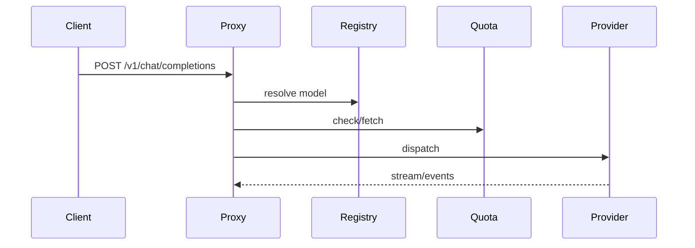

# Providers

> Merged: Providers + Auth Refresh + Proxy Pool + WireGuard Pool + Cache Hit — full provider surface.



```text
ASCII: Registry(47 defs) -> Discovery(fetch-models/cursor/devin) -> Auth Refresh(lease/CAS) -> Quota -> Proxy Pool(SOCKS) / WireGuard -> Cache Plan(prefix) -> Upstream
```

## 1. Registry & Catalog

## Access classification

Provider definitions are owned by `src/providers/model-catalog.ts`, `src/providers/oauth-provider/provider-definitions.ts`, `src/providers/api-key/*`, `src/providers/web-search/*`, and `src/providers/api-key/custom-provider.ts`.

The current built-in registry contains 47 definitions (authoritative `builtinProviderDefinitions()` in `src/providers/registry.ts` + `OAUTH_PROVIDER_DEFINITIONS` in `src/providers/oauth-provider/provider-definitions.ts`):

- **10 OAuth:** `antigravity` (gemini), `codex` (openai), `claude` (anthropic), `zaicp` (openai, oauth+api_key), `kimi-code` (openai), `github` (openai), `cursor` (openai), `devin` (openai), `cline` (openai, oauth+api_key), `cline-pass` (openai, oauth+api_key).
- **37 API-key definitions:** `openai`, `anthropic`, `gemini`, `openrouter`, `groq`, `alibaba`, `fireworks`, `deepseek`, `mistral`, `siliconflow`, `cerebras`, `nvidia`, `xiaomipg`, `xiaomitp`, `blackboxai`, `ollama`, `cloudflare`, `cb`, `cbcn`, `opencodeft`, `opencodezen`, `opencodego`, `commandcode`, `qoder`, `agentrouter`, `exa`, `devin-search`, `perplexity`, `parallel`, `inferhub`, `gmi`, `zai`, `alibabacp`, `hermes`, `bai`, `tokenharbor`, `aihubmix` (per `src/providers/registry.ts` `API_KEY_PROVIDER_DEFINITIONS`) assembled by `src/providers/default-registry.ts` (display names: CodeBuddy/`cb`, CodeBuddy CN/`cbcn`, GMI Cloud/`gmi`, Alibaba Coding Plan/`alibabacp`, Nous Research/`hermes`).
- **Custom:** database-defined providers projected by `customProviderDefinition`; the count is runtime/database dependent.

The authoritative list is `builtinProviderDefinitions()` and its registry test. Do not duplicate a provider list in application code or configuration documentation when the definition source changes.


## Reasoning capability matrix

| Provider family | Reasoning signal | Effort / Mode | Signature |
|---|---|---|---|
| `anthropic` (Messages, OAuth) | `thinking` block + `signature` | `thinking.type: adaptive` + `display: summarized/omitted`, `effort` via header `effort-2025-11-24` | `signature` per block, interleaved `interleaved-thinking-2025-05-14` |
| `openai` Responses | `reasoning` item `id/summary/encrypted_content` | `reasoning.effort=minimal..xhigh/max`, `mode=standard/pro`, `summary=auto/concise/detailed`, `context` | `encrypted_content` / `id` for ZDR, `previous_response_id` fidelity |
| `openai` Chat compat (BAI, TokenHarbor, AiHubMix, Ollama, etc) | `reasoning_content` / `reasoning_details[]` / `<think>` tag | Compat maps to `thinking_delta` via `transformOpenAIChatStream` | `thought_signature` via `extra_content.google` |
| Third-party compat (DeepSeek, Qwen) | `reasoning_details` array | Mapped to `thinking_delta` | — |

Oh My Omop - Router normalizes all three to `ContentPart reasoning` + `thinking_delta` with `reasoningSignature` preserved.

## Registry and adapter ownership

`src/providers/registry.ts` contains registration and target-resolution mechanics (`providerAccessFor`, `builtinProviderDefinitions`). `src/providers/default-registry.ts` composes the eager built-in set: 41 eager adapters + 5 lazy (`codex`, `claude`, `antigravity`, `cursor`, `devin` via `loadOptionalProvider`) → `registry.size 46` (vs 47 definitions; `kimi-code` has no eager adapter, `zai` duplicated via `new ZaiProvider("zaicp")` — intentional divergence verified in `src/providers/provider-registry.test.ts`: `definitions.length 47, oauth 10, registry.size 46`). Each adapter owns its provider upstream dispatch, credential interpretation, protocol capabilities, model catalog, and error normalization. OAuth drivers are resolved through `src/auth/driver-registry.ts`.

Custom providers use the same canonical protocol surfaces but obtain endpoint/auth/profile data from PostgreSQL. There is no central project-owned codec or generic provider transport module.

## Model catalog and discovery

`src/providers/model-catalog.ts` merges static and discovered models by id. The merge keeps the largest known input context and retains a static fallback when discovery is unavailable.

Discovery: `src/providers/fetch-models.ts` (openai-compatible tolerant `/models` parsing + generic five-minute `refreshGenericProviderCatalog` per `src/runtime/runtime.ts` bounded limits) + OAuth inline discovery:
- `src/providers/oauth-provider/cursor.ts:GetUsableModels` + `src/providers/oauth-provider/cursor/agent_pb.ts` — HTTP/2 `POST https://api2.cursor.sh/agent.v1.AgentService/GetUsableModels` with `Authorization: Bearer <token>` + `x-cursor-client-version: cli-2026.02.13-41ac335` (`Run` uses `cli-2026.07.23-e383d2b`), Connect unary framing (5-byte flag+length, gzip 0x01 fallback), `GetUsableModelsRequest/Response` protobuf, static fallback 7 models (`default`, `claude-4.5/4.6-opus/sonnet`, `composer-2.5/fast`) with 200k/64k context.
- `src/providers/oauth-provider/devin.ts:GetCliModelConfigs` + `src/providers/oauth-provider/devin/proto-gen/exa/api_server_pb/api_server_pb.ts` + `src/providers/oauth-provider/devin/proto-gen/exa/codeium_common_pb/codeium_common_pb.ts` — `POST https://server.codeium.com/exa.api_server_pb.ApiServerService/GetCliModelConfigs` with `Authorization: Bearer <token>` (`normalizeDevinSessionToken`), `Metadata{ideName:WINDSURF}` protobuf, gzip + Connect 5-byte frame handling, maps `ClientModelConfig{label, modelUid, modelOrAlias, maxTokens, supportsImages, disabled}` → `capabilitiesOf({surfaces:[openai-responses], streaming, reasoning, images})`. Static fallback `swe-1-6-slow` 200k/64k.
- `src/providers/fetch-models.ts` still owns generic openai-compatible `/models` tolerant parsing; codex/antigravity failover + `lastGoodEndpoint` per-credential 5m cache via `fetchCodexModels`/`fetchAntigravityDiscoveryModels`. `@bufbuild/protobuf` `create/fromBinary/toBinary` is imported directly in `cursor.ts`/`devin.ts` (no `src/proto` barrel).
- Generic OpenAI-compatible gateways:
  - `src/providers/api-key/bai.ts` — `https://api.b.ai/v1` (B.AI) multi-surface `openai-chat` + `openai-responses` + `anthropic-messages`, auth `Bearer sk-...` or `x-api-key`, discovery `GET /v1/models`, dispatch per `target.surface` to `dispatchChatCompletions` / `dispatchResponses` / `dispatchAnthropic` via `src/proxy/upstream/{openai,anthropic}.ts` (https://docs.b.ai/llmservice/api/).
  - `src/providers/api-key/tokenharbor.ts` — `https://tokenharbor.ai/v1` (TokenHarbor) `thk_live_...`, surfaces `openai-chat` + `openai-responses`, discovery `/v1/models` (https://tokenharbor.ai/docs/getting-started/quickstart).
  - `src/providers/api-key/aihubmix.ts` — `https://aihubmix.com/v1` (AiHubMix) `sk-...`, surfaces `openai-chat` + `openai-responses`, discovery legacy `GET /v1/models` tolerant + fallback `GET https://aihubmix.com/api/v1/models` (`model_id` mapping) (https://docs.aihubmix.com/en/api/Models-API).

Discovery is linked to model fetching for generic API-key providers; it is not a required registry-startup network call. When `discoverModels` receives empty credential it returns `null` and the static fallback model remains visible.

## OAuth identity boundary

OAuth adapters retain reference-client identities on upstream requests. Local `OHMYOMOP_ROUTER_VERSION` is used only for local health/version surfaces, dashboard identity and logs. Antigravity (`antigravity/hub/<version>`), Codex (`codex-cli/<version>` + `chatgpt-account-id`), Claude Code (`claude-code` + betas), Cursor (`x-cursor-client-version` + HTTP/2), Devin (`devin-session-token$` + `WINDSURF` Metadata) each own their required user-agent/header behavior in their adapter module (`src/providers/oauth-provider/*`).

## Protocol ownership

Provider adapters receive canonical request types and return canonical response/stream events. Protocol normalization and surface projection remain in `src/proxy/*`; provider-specific upstream dispatch stays under `src/proxy/upstream/*` (`openai.ts: dispatchChatCompletions/dispatchResponses + transformOpenAIChatStream/ResponsesStream`, `anthropic.ts: dispatchAnthropic + transformAnthropicMessagesStream`, `gemini.ts: dispatchGemini + transformGeminiGenerateContentStream`, `adapter.ts`, `compatibility.ts`, `protobuf.ts`).

## Operational guidance

1. Add a built-in provider through its owning adapter and provider definition.
2. Add OAuth only through an `AuthDriver` registration.
3. Keep static fallback models when discovery fails.
4. Preserve sanitized provider errors and route scope so retry policy remains correct.
5. Run `bun run version:check`, `bunx tsc --noEmit`, provider tests and `bun run scripts/dev/verify.ts` after registry changes.

## Reproduce provider registry and discovery

Run the deterministic registry/catalog tests:

```sh
bun test src/providers --timeout 60000
# or granular:
bun test src/providers/provider-registry.test.ts src/providers/model-catalog.test.ts --timeout 60000
```

The tests verify built-in definitions (`47`), access classification (`10 oauth` + `37 api_key`), eager registry size (`46` = 41 eager +5 lazy; `kimi-code` has no eager adapter), model merge behavior and tolerant discovery parsing without requiring provider credentials. `glob src/providers/**/*.test.ts` shows 11 provider test files.

With a console session, inspect the runtime registry projection:

```sh
curl -sS http://127.0.0.1:12800/console/api/providers \
  -H "Cookie: ohmyomop_router_console=$CONSOLE_SESSION" | jq .
curl -sS http://127.0.0.1:12800/v1/models \
  -H "x-api-key: $PROXY_API_KEY" | jq .
```

The first response shows provider definitions/configuration state; the second shows models visible to the API key. Live discovery only occurs when the selected provider/account path requests it (credential non-empty), so a static fallback can appear when the upstream catalog is unavailable or credential empty (`discoverModels` returns `null`).

## 2. Auth Refresh & Quota

## Two background concerns

| Component | Source | Responsibility |
|---|---|---|
| OAuth refresh pool | `src/auth/refresher.ts` | Fresh access tokens, single-flight refresh, leases, retry state |
| Quota worker | `src/auth/refresher.ts (QuotaRefreshWorker) + src/bootstrap/quota.ts` | Provider quota/limit refresh into `provider_account_quota` |

Both use PostgreSQL-backed account state and the shared coordination boundary. Redis is used when configured; local bounded coordination is the fallback.

## OAuth lifecycle

```text
provider account
  → read encrypted credential
  → check expiry with skew
  → single-flight refresh per account
  → acquire distributed/local refresh lease
  → provider token request
  → fingerprint/CAS write
  → return TokenLease
  → release exactly once
```

A refresh winner persists the new token only when the expected generation/fingerprint still matches. A losing process rereads the current account token instead of overwriting it. Concurrent requests for one account share the same in-flight refresh promise.

Refresh failures record sanitized error kind, retry time and failure count. The account remains in a retrying state until refresh succeeds or operator action changes its credential.

## Reactive refresh

During request execution, an OAuth `401`/`403` classified as authentication or authorization failure can schedule a non-blocking `forceRefresh(accountId)`. The current request still obeys its total deadline and retry policy; refresh does not create an unbounded retry loop.

## Quota refresh

`fetchProviderQuota` dispatches by provider id via `src/providers/quota-fetch/fetch.ts:QUOTA_FETCHERS` (12 entries, `unsupportedQuota` fallback) and `src/bootstrap/quota.ts:supportsProvider` gating in `QuotaRefreshWorker`:

- **Quota dispatch namespace** (`QUOTA_FETCHERS` keys in `src/providers/quota-fetch/fetch.ts:15`): `antigravity`, `claude` (short, not `claude-code`), `cline`, `cline-pass`, `codex`, `ollama`, `zai`, `zaicp` (both map to `fetchZaiQuota`; `zaicp` normalizes source to `"zaicp"`), `kimi-code`, `github` (short, not `github-copilot`, maps to `fetchGithubCopilotQuota`), `cursor`, `devin`. Verify via `grep -rn QUOTA_FETCHERS src/providers/quota-fetch/fetch.ts`.
- **Auth-driver namespace** (`src/auth/driver-registry.ts:createAuthDriverRegistry`, 10 drivers): `antigravity`, `claude-code` (Anthropic OAuth, not `claude`), `cline`, `cline-pass`, `codex`, `zai-coding-plan` (not `zaicp`/`zai`), `kimi-code`, `github-copilot` (not `github`), `cursor`, `devin`. Provider definitions in `src/providers/oauth-provider/provider-definitions.ts` use the short ids `claude`/`zaicp`/`github` (10 entries). The two namespaces are deliberately distinct: quota fetch and provider catalog use short ids, driver registry lookup uses namespaced ids (`claude-code`, `zai-coding-plan`, `github-copilot`). Do not conflate them.
- **Quota worker gating** (`src/bootstrap/quota.ts:245`): `supportsProvider` Set 11 — `antigravity`, `claude-code`, `cline`, `codex`, `ollama`, `zai`, `zai-coding-plan`, `kimi-code`, `github-copilot`, `cursor`, `devin`. Note `zai` is included though no driver exists for plain `zai`, and `ollama` has a quota fetcher but no OAuth driver; `zai` + `zai-coding-plan` are both accepted so either dispatch id passes the gate. Verify via `read src/bootstrap/quota.ts:240-250`.

The quota worker (`src/auth/refresher.ts (QuotaRefreshWorker) + src/bootstrap/quota.ts` — bounded periodic, `supportsProvider` filter) performs bounded work and the console exposes manual `POST /console/api/accounts/:id/quota/refresh`. Quota and health/cooldown state affect account eligibility during route planning. On 404 `fetchCursorQuota` returns `{source:"cursor", plan:null, windows:[], error:"No Cursor plan"}` not empty; `fetchDevinQuota` uses Windsurf `SeatManagementService/GetUserStatus` (credit windows + daily/weekly remaining) else `unsupportedQuota` fallback.

## Observability and operations

Monitor account health, `retryAt`, refresh state, refresh failure count and quota timestamps in the console. Relevant runtime evidence is available through overhead phases and telemetry; credential values and bearer tokens are never written to telemetry.

Operational checklist:

- Keep an OAuth refresh token persisted for providers that require refresh.
- Do not edit encrypted credential columns manually.
- Investigate repeated `authentication_failed` events together with account health and refresh retry state.
- Verify PostgreSQL readiness before diagnosing provider refresh failures.

## Reproduce auth/cache behavior

The API-key cache behavior is deterministic and does not require a provider:

```sh
bun test src/console/services/api-keys.test.ts \
  src/proxy/routing/routing-reliability.test.ts \
  --timeout 60000
```

The tests cover active records, revoked records after cache expiry, cache TTL, repository snapshot invalidation, and the rule that non-retryable errors do not invoke a second route candidate.

For a live OAuth flow:

```sh
curl -i http://127.0.0.1:12800/console/api/providers \
  -H "Cookie: ohmyomop_router_console=$CONSOLE_SESSION"
curl -i -X POST http://127.0.0.1:12800/console/api/accounts/<ACCOUNT_ID>/quota/refresh \
  -H "Cookie: ohmyomop_router_console=$CONSOLE_SESSION"
```

The OAuth start/callback flow requires a provider account and its real authorization endpoint. Do not paste access or refresh tokens into shell history or documentation.

## 3. Proxy Pool

## Ownership

| Concern | Source |
|---|---|
| PostgreSQL proxy configuration | `src/persistence/repositories/proxies.ts` and console proxy services |
| Network selection | `src/proxy/request/prepare.ts`, `attempt.ts`, `executor.ts` |
| Transport | `src/proxy/transport/fetch.ts`, `proxy-fetchers.ts`, `network.ts` |
| Console UI | dashboard proxy request feature |

Supported outbound protocols are HTTP, HTTPS and SOCKS5 (`socks-proxy-agent` with keepAlive). Proxy records carry endpoint, active state, priority/weight, concurrency and sanitized health/test state.

## Transport behavior

```text
NetworkSelector
  → direct upstream or selected proxy
  → HTTP/HTTPS fetcher, SOCKS5 agent, or relay fetcher
  → AbortCoordinator signal
  → upstream executor and provider protocol
```

SOCKS5 agents use keep-alive connections and a bounded process cache (`src/proxy/transport/network.ts` evict oldest). Every proxy URL is validated via `src/proxy/transport/network.ts` before use; credentials are never copied into telemetry messages.

## Health and capacity

The console can create/update/delete, enable/disable, test and bulk-manage proxies. Health state is sanitized and includes test timestamps/latency where available. `maxConcurrency` limits per-proxy in-flight work; weight/priority participate in candidate ordering.

## Failover

Failover is owned by request routing, not by the low-level fetcher. A proxy/network error is retryable only when its mapped error is retryable, the route has another candidate, the total request deadline remains, and semantic output has not committed. A non-retryable error releases its lease and propagates immediately.

The stream commit gate prevents retry after semantic output (`text_delta`, thinking, tool output or terminal event) has reached the client.

## Operations

1. Keep at least two active proxies when failover is required.
2. Set concurrency based on provider and proxy capacity, not only socket capacity.
3. Run proxy tests after changing endpoint or credentials.
4. Monitor health and `/health/overhead` upstream phases.
5. Keep the SOCKS cache bounded; do not introduce an unbounded per-request agent map.

## Reproduce proxy selection and failover

With a console session, list and test configured proxies. The proven endpoints are `POST /console/api/proxies/test` (ad-hoc) and `POST /console/api/proxies/:id/test` (stored or override) per `src/console/api.ts:442-454` and `src/console/services/proxy-pool.ts:83-115`:

```sh
curl -sS http://127.0.0.1:12800/console/api/proxies \
  -H "Cookie: ohmyomop_router_console=$CONSOLE_SESSION" | jq .

# Ad-hoc test — always requires body { protocol?, host, port } (src/console/services/proxy-pool.ts:83-97)
curl -sS -X POST http://127.0.0.1:12800/console/api/proxies/test \
  -H "Cookie: ohmyomop_router_console=$CONSOLE_SESSION" \
  -H "Content-Type: application/json" \
  -d '{"protocol":"http","host":"1.2.3.4","port":8080}' | jq .

# Stored-config test — empty object uses the saved endpoint via testOne(id) (src/console/services/proxy-pool.ts:98-115)
curl -sS -X POST http://127.0.0.1:12800/console/api/proxies/<PROXY_ID>/test \
  -H "Cookie: ohmyomop_router_console=$CONSOLE_SESSION" \
  -H "Content-Type: application/json" -d '{}' | jq .

# Per-ID body-required variant — when only proxies.test is wired, the per-ID route
# falls back to test(body) and requires body !== undefined (src/console/api.ts:451-453);
# also usable as an override to test a different host/port against the same proxy id
curl -sS -X POST http://127.0.0.1:12800/console/api/proxies/<PROXY_ID>/test \
  -H "Cookie: ohmyomop_router_console=$CONSOLE_SESSION" \
  -H "Content-Type: application/json" \
  -d '{"protocol":"socks5","host":"127.0.0.1","port":11080}' | jq .
```

For a deterministic transport smoke test:

```sh
bunx tsc --noEmit
bun test src/proxy/transport src/proxy/routing --timeout 60000
```

To observe real failover, configure two active proxies that can reach the same provider, make the first unavailable, and send a request before semantic output commits. The request may select the second candidate only when the mapped error is retryable and the single total deadline still has time. After the first semantic stream event, retry is intentionally disabled.

## 4. WireGuard Pool

Oh My Omop - Router's WireGuard pool is an optional Go sidecar. It uses userspace WireGuard and gVisor netstack, exposes one local SOCKS5 endpoint per tunnel, and registers those endpoints as PostgreSQL-backed proxy records through the console API. Oh My Omop - Router itself only sees normal proxy records and does not manage kernel WireGuard devices.

## Generate WARP configurations

`scripts/warp-generate.ts` uses Bun and `@noble/curves` X25519 instead of a platform `wg` binary. It registers public keys through the Cloudflare WARP endpoint (`WARP_API_URL https://api.cloudflareclient.com/v0a737/reg`, `WARP_MTU 1280`) and writes compatible INI files:

```sh
bun run warp:generate --count 1
bun run warp:generate --count 5 --out ./pool
bun run warp:generate --count 50 --out ./pool
```

Generated files use standard `[Interface]`/`[Peer]` INI sections. Relevant overrides are `WARP_API_URL`, `WARP_MTU`, `WARP_DNS`, `WARP_ALLOWED_IPS`, `WARP_DEVICE_TYPE`, and `WARP_LOCALE`.

## WireGuard sidecar — proven binary entrypoint

`vendor/wireproxy` is a library package (`package wireproxy`, `module github.com/windtf/wireproxy`) — it has no `main` and `go run ./vendor/wireproxy` is not a valid entrypoint. The proven entrypoint is the `wireproxy` binary built from `vendor/wireproxy/cmd/wireproxy`:

```sh
# from repository root
make -C vendor/wireproxy
# or
go build -trimpath -ldflags "-s -w" -o ./bin/wireproxy ./vendor/wireproxy/cmd/wireproxy
# Windows
go build -trimpath -ldflags "-s -w" -o ./bin/wireproxy.exe ./vendor/wireproxy/cmd/wireproxy
```

Runtime usage (verified in `src/console/api.ts:51-53,102-108,525-533,586`):

```sh
# validate a config before import
./bin/wireproxy -n -c ./data/wireguard/wg-us-01-11080.conf

# run a single tunnel (one SOCKS5 listener per tunnel)
./bin/wireproxy -c ./data/wireguard/wg-us-01-11080.conf
```

In production Oh My Omop - Router spawns one `wireproxy` process per tunnel via `Bun.spawn([wireproxyBin, "-c", configPath])` and persists the mapping in `wireguard_tunnels` (`socks5://127.0.0.1:11080+N`, `src/console/api.ts:47-49,562-616`). The `[Socks5] BindAddress = 127.0.0.1:<port>` section is appended automatically if missing. Each tunnel forwards supported AmneziaWG fields (`Jc`/`Jmin`/`Jmax`/`S1`/`S2`/`H1`..`H4` per `vendor/wireproxy/config.go`) when present and applies configured per-proxy capacity.

## Environment ownership

| Variable | Owner | Default / location |
|---|---|---|
| `WIREPROXY_BIN` | Bun proxy (`src/console/api.ts` reads `Bun.env.WIREPROXY_BIN`, fallback `./bin/wireproxy.exe`) | `.env.example:22` `WIREPROXY_BIN=./bin/wireproxy.exe` |
| `WIREGUARD_CONFIG_DIR` | Bun proxy — directory where `POST /console/api/wireguard/import` writes `*.conf` files | `.env.example:23` `./data/wireguard` |
| `WIREGUARD_START_PORT` | Bun proxy — first `socks5://127.0.0.1:<port>` to allocate, incremented per import (`src/console/api.ts:566-570`) | `.env.example:24` `11080` |
| `GOMEMLIMIT` / `GOGC` | Go runtime for the `wireproxy` sidecar processes only (`GOMEMLIMIT=800MiB GOGC=50` for ~50 tunnels) | `vendor/wireproxy/TUNING_1GB.md` — not Bun proxy settings |
| `WARP_API_URL` / `WARP_MTU` etc. | `scripts/warp-generate.ts` only | `WARP_API_URL=https://api.cloudflareclient.com/v0a737/reg` `WARP_MTU=1280` |
| `OHMYOMOP_ROUTER_URL` / `PROXY_API_KEY` pool registration | Not used by the proven console path — `vendor/wireproxy/pool.go:PoolManager` fields exist in library code but the active registration path is server-side `POST /console/api/wireguard/import` → `proxies` table (`src/console/api.ts:562-616`); do not set `OHMYOMOP_ROUTER_URL`/`PROXY_API_KEY` for pool startup in this mode | Removed from pool instructions |

`.env.example` values for `WIREPROXY_BIN` / `WIREGUARD_CONFIG_DIR` / `WIREGUARD_START_PORT` are consumed by the Bun process; they are not wireproxy INI directives. `GOMEMLIMIT`/`GOGC`/`WARP_*` are not required by the Bun proxy.

## Console integration

The dashboard Proxy Pool page and `GET /console/api/wireguard/status` are the source of truth after import. The active console endpoints (verified in `src/console/api.ts:456-616` and `src/console/services/proxy-pool.ts:98-115`) are:

| Method | Path | Purpose |
|---|---|---|
| `POST` | `/console/api/wireguard/import` | Persist INI (`{ name?, content, port? }` → `content` must contain `[Interface]`/`[Peer]` + `PrivateKey`/`PublicKey`), write `WIREGUARD_CONFIG_DIR/<name>-<port>.conf` with `wireguardConfigWithSocks`, validate via `wireproxy -n -c`, `Bun.spawn([wireproxyBin, "-c", ...])`, create `socks5://127.0.0.1:<port>` proxy record and `wireguard_tunnels` row |
| `POST` | `/console/api/wireguard/validate` | Validate INI without persisting (`{ content }` → `wireproxy -n -c` temp file) |
| `POST` | `/console/api/wireguard/warp/create` | Generate one WARP INI via `bun run scripts/warp-generate.ts` |
| `GET` | `/console/api/wireguard/status` | `{ enabled, running, total, tunnels[] }` — `tunnels` joined from `wireguard_tunnels` + `wireguardProcesses` + `proxies.active` |
| `POST` | `/console/api/wireguard/toggle` | `{ enabled: boolean }` → flips `wireguard_pool_settings.enabled`, kills or re-spawns tunnel processes, updates `proxies.active` |
| `POST` | `/console/api/proxies/:id/test` | Health for a single tunnel (uses stored endpoint via `testOne`, see `docs/PROXY_POOL.md`) |
| `GET` | `/console/api/proxies` | List all proxy records including WireGuard SOCKS endpoints |

After registration, test each endpoint from the dashboard or `POST /console/api/proxies/:id/test` before enabling it for routing. Proxy health, weight and concurrency remain governed by the normal proxy pool path (`src/persistence/repositories/proxies.ts`, `src/proxy/request/*`, `src/proxy/transport/fetch.ts`). The 50-tunnel memory target is an operational tuning target, not an API guarantee — measure RSS and provider traffic on the target host before scaling.

## Security

Keep the registration console session out of shell history where practical. Bind local SOCKS listeners to `127.0.0.1` unless deliberate network exposure is required (default `BindAddress = 127.0.0.1:<port>`). Treat imported INI files as credentials and do not commit them. `wireguard_tunnels.config_path` stores the on-disk path (`WIREGUARD_CONFIG_DIR`) — restrict filesystem permissions accordingly.

## Reproduce a small pool (via console API)

Generate one configuration:

```sh
bun run warp:generate --count 1 --out ./pool
```

Validate it without persisting:

```sh
curl -sS -X POST http://127.0.0.1:12800/console/api/wireguard/validate \
  -H "Cookie: ohmyomop_router_console=$CONSOLE_SESSION" \
  -H "Content-Type: application/json" \
  -d "{\"content\": $(jq -Rs . < ./pool/warp-01.conf)}" | jq .
```

Import it — the server validates with `wireproxy -n -c`, spawns `wireproxy -c`, and registers `socks5://127.0.0.1:<port>`:

```sh
curl -sS -X POST http://127.0.0.1:12800/console/api/wireguard/import \
  -H "Cookie: ohmyomop_router_console=$CONSOLE_SESSION" \
  -H "Content-Type: application/json" \
  -d "{\"name\":\"wg-test-01\",\"content\": $(jq -Rs . < ./pool/warp-01.conf)}" | jq .

curl -sS http://127.0.0.1:12800/console/api/wireguard/status \
  -H "Cookie: ohmyomop_router_console=$CONSOLE_SESSION" | jq .

curl -sS http://127.0.0.1:12800/console/api/proxies \
  -H "Cookie: ohmyomop_router_console=$CONSOLE_SESSION" | jq .
```

Expected observation: `GET /console/api/wireguard/status` reports `running: 1` and `GET /console/api/proxies` contains a `socks5://127.0.0.1:11080` record. Test it before enabling for routing:

```sh
curl -sS -X POST http://127.0.0.1:12800/console/api/proxies/<PROXY_ID>/test \
  -H "Cookie: ohmyomop_router_console=$CONSOLE_SESSION" \
  -H "Content-Type: application/json" -d '{}' | jq .
```

This requires a built wireproxy binary (`make -C vendor/wireproxy` → `./bin/wireproxy`), network access to the WARP registration endpoint for generation, and a running Oh My Omop - Router instance with PostgreSQL. Use a manually prepared INI when WARP registration is unavailable. The binary validates and runs on Linux/macOS/Windows; the `WIREPROXY_BIN=./bin/wireproxy.exe` default in `.env.example` reflects the Windows path — use `./bin/wireproxy` on Unix.

WireGuard tunnel lifecycle is owned by `vendor/wireproxy` (library) as spawned by the console API; Oh My Omop - Router only governs proxy health/selection. For capacity tuning see `vendor/wireproxy/TUNING_1GB.md` (`GOMEMLIMIT=800MiB GOGC=50`, `MaxConcurrency=20`, staggered `Up()` 100 ms, global gVisor `sync.Pool`).

## 5. Cache Hit

Oh My Omop - Router does not implement a provider cache. It computes a stable prefix, attaches provider-supported cache metadata, and forwards the request. Provider usage is the only evidence of a provider-side hit or write.

## Cache path

```text
public request
  → protocol normalization (src/proxy/*)
  → router/cache-plan.ts  (pure classification: sections, stability, FNV-1a fingerprint)
  → router/route.ts re-export + router/request/prepare.ts integration (shouldBuildCachePlan threshold, buildCachePlan/applyCachePlan with affinity)
  → compression/filter policy (fused)
  → provider payload builder (src/providers/* adapters map plan → native cache markers)
  → provider-owned cache
```

`src/proxy/translate/request.ts (buildCachePlan/applyCachePlan)` is the single owner of the cache plan: `CacheSectionKind` (`system`/`developer`/`tools`/`static_context`/`stable_history`/`dynamic`), `shouldBuildCachePlan(request)` (threshold `CACHE_PLAN_MESSAGE_THRESHOLD` 3 — builds only if `tools.length>0` or `messages.length>3`), `buildCachePlan`, `applyCachePlan` (FNV-1a 64-bit `prefixFingerprint` + `request.model` + `request.sourceSurface` + `affinityKey` → `cacheKey`/`prompt_cache_key`), `looksStableText`/`stablePrefixText` (rejects timestamps, UUIDs, PEM blocks), and breakpoint helpers (`findCacheBreakpoint`, `applyOpenAIChatCacheBreakpoint`, `applyOpenAIResponsesCacheBreakpoint`, `supportsOpenAIPromptBreakpoints`). `src/proxy/routing/plan.ts` re-exports the plan helpers; `src/proxy/request/prepare.ts:534` wires `applyCachePlan(buildCachePlan(...), affinityKey)` into the single `messages.map` fused compression pass. Provider adapters translate the plan to native markers; there is no toggle, config row, or persisted prefix anywhere in this module.

The path is shared by Chat Completions, Responses and Anthropic Messages. Cache metadata is request/route metadata; it is not a local boolean claiming a hit. Verify via `grep -rn "buildCachePlan\|shouldBuildCachePlan" src/proxy/routing/`.

## Stable prefix rules

Stable system/developer content, stable history and stable tool definitions can form the prefix. Volatile timestamps, UUIDs, request IDs and PEM-like content shorten or invalidate it. Keep stable content first and put the changing user request at the end.

Tool names, order, descriptions and schemas must remain byte-stable. Model, surface and affinity namespace are part of the cache identity; changing them intentionally creates a different namespace.

## Provider-specific behavior

- Anthropic receives `cache_control` on supported stable blocks.
- OpenAI Chat and Responses preserve canonical stable-prefix metadata and provider-supported cache extensions (`prompt_cache_key` always preserved; explicit `cache_control`/`prompt_cache` markers stripped/restored via `stripOpenAIPromptCacheMetadata`).
- Other providers may ignore cache metadata; the request remains valid.

## Evidence

Inspect provider usage fields rather than Oh My Omop - Router-only telemetry:

| Surface | Typical evidence |
|---|---|
| OpenAI Chat | `usage.prompt_tokens_details.cached_tokens` |
| OpenAI Responses | `usage.input_tokens_details.cached_tokens` |
| Anthropic Messages | `usage.cache_read_input_tokens` |
| Cache creation, when exposed | provider-specific write/creation token field |

Provider responses may omit write metrics or use different accounting. Do not infer a write from a successful request or fabricate a cache count in telemetry.

## Operational checklist

1. Keep the same model, surface and affinity namespace.
2. Keep the stable prefix and tool definitions unchanged.
3. Remove timestamps/request IDs from prompt content.
4. Repeat the request only after the first request succeeds.
5. Compare provider usage fields across the repeated requests.

Ownership: `src/proxy/translate/request.ts (buildCachePlan/applyCachePlan)` (classification + fingerprint), `src/proxy/routing/plan.ts` (re-export), `src/proxy/request/prepare.ts` (affinity-aware integration), provider adapters in `src/providers/*` + `src/proxy/normalize/openai.ts`/`openai-payload.ts`/`src/proxy/normalize/anthropic.ts` (native marker mapping). `src/persistence/telemetry/pipeline.ts` only records safe metadata — it does not implement or claim cache hits. Verify via `read src/proxy/translate/request.ts (buildCachePlan/applyCachePlan):1-60` and `grep -rn "applyCachePlan" src/proxy/request/prepare.ts`.

## Reproduce a cache observation

Use a stable prompt and the same model, surface and affinity header twice:

```sh
payload='{"model":"openai/gpt-4o-mini","messages":[{"role":"system","content":"You are a cache test assistant. Keep this instruction unchanged."},{"role":"user","content":"Changing question"}],"stream":false}'

curl -sS http://127.0.0.1:12800/v1/chat/completions \
  -H "x-api-key: $PROXY_API_KEY" \
  -H "x-ohmyomop-router-affinity: cache-repro-1" \
  -H "content-type: application/json" \
  -d "$payload" | jq '.usage'

curl -sS http://127.0.0.1:12800/v1/chat/completions \
  -H "x-api-key: $PROXY_API_KEY" \
  -H "x-ohmyomop-router-affinity: cache-repro-1" \
  -H "content-type: application/json" \
  -d "$payload" | jq '.usage'
```

Compare the provider-specific cached-token fields listed above. A zero value is a valid observation: the selected provider/model may not report a cache read. Repeat the same experiment with `/v1/responses` or `/v1/messages` and compare the corresponding usage field. This requires an upstream that supports and reports prompt caching; Oh My Omop - Router cannot force or simulate it.

---
_Merged from PROVIDERS.md + AUTH_REFRESH.md + PROXY_POOL.md + WIREGUARD_POOL.md + CACHE_HIT.md_
